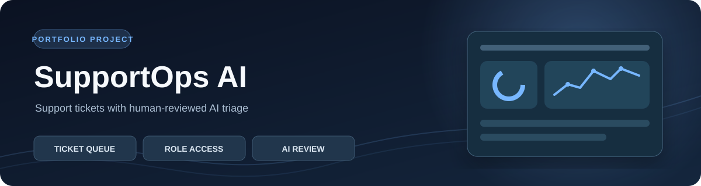
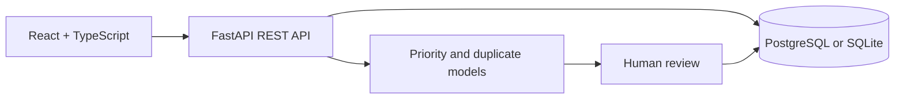

<div align="center">
  

  # SupportOps AI

  **A customer support workspace with human-reviewed AI triage.**

  [Live demo](https://supportops-ai-demo.onrender.com/) · [Source code](https://github.com/HARSH-1607/supportops-ai) · [API docs](https://supportops-ai-demo.onrender.com/docs)
</div>

> **Explore the demo:** Open the dashboard, search fictional tickets, and inspect priority and duplicate suggestions. The public site has viewer-only access. Agent and admin actions are available locally. Hosted data may reset after a service restart; do not enter real customer data.

## What it does

| Area | Implementation |
| --- | --- |
| Ticket workflow | Create, search, filter, assign, comment, and move tickets through open, in progress, waiting, and resolved states. |
| AI-assisted triage | TF-IDF plus logistic regression suggests priority; character n-gram similarity identifies possible duplicates. A person confirms or overrides both. |
| Operations dashboard | Status and priority mix, ticket volume, agent workload, urgent tickets, and unreviewed queues. |
| Access and audit | Admin, agent, and viewer roles; bearer-token sessions, salted scrypt password hashes, activity history, and version checks against stale updates. |

## Architecture



Python, FastAPI, SQLAlchemy, and scikit-learn power the backend. React, TypeScript, and Vite power the UI. SQLite simplifies local setup; Docker Compose runs PostgreSQL.

## Run locally

Requires Python 3.11+ and Node.js 20+. From the repository root in PowerShell:

```powershell
python -m venv .venv
.\.venv\Scripts\Activate.ps1
pip install -r backend\requirements.txt
cd frontend
npm ci
npm run build
cd ..\backend
$env:SUPPORTOPS_DEMO = "1"
uvicorn app.main:app --host 127.0.0.1 --port 8000
```

Open <http://127.0.0.1:8000>. The first demo launch creates a SQLite database, three accounts, and four fictional tickets.

| Local role | Email | Password |
| --- | --- | --- |
| Admin | `admin@demo.local` | `DemoPass123!` |
| Agent | `agent@demo.local` | `DemoPass123!` |
| Viewer | `viewer@demo.local` | `DemoPass123!` |

These credentials are **only for local evaluation**. Demo accounts are disabled by default. For a non-demo first run, omit `SUPPORTOPS_DEMO` and set `BOOTSTRAP_ADMIN_EMAIL` and `BOOTSTRAP_ADMIN_PASSWORD`. For frontend development, run `npm run dev` in `frontend` while the API runs on port 8000. For PostgreSQL, copy `.env.example` to `.env`, replace sample passwords, and run `docker compose up --build`.

## API and verification

| Route | Purpose |
| --- | --- |
| `POST /api/auth/login`, `GET /api/me` | Sign in and load the user |
| `GET/POST /api/tickets`, `GET/PATCH /api/tickets/{id}` | Search, create, read, and update tickets |
| `GET /api/tickets/{id}/suggestions`, `POST /api/tickets/{id}/review` | Inspect AI suggestions and record the final decision |
| `POST /api/tickets/{id}/comments` | Add an internal note |
| `GET /api/dashboard`, `GET /api/audit` | Operations metrics and audit history |
| `GET/POST /api/users`, `PATCH /api/users/{id}` | Manage users and roles |

Interactive API documentation is at `/docs`. Run `cd backend; pytest -q` for backend tests. They cover permissions, ticket operations, AI suggestions, human review, duplicate links, dashboard metrics, audit history, and optimistic concurrency. GitHub Actions checks backend tests, frontend formatting, and the production build.

## Limits

The priority model is trained on a small set of example text; its score is **not calibrated certainty**. Duplicate detection compares up to 500 recent tickets and never merges automatically. Production use would require historical labeled data, model evaluation, migrations, login rate limits, monitoring, and stronger session management. This is a portfolio demo, not a production support system.
